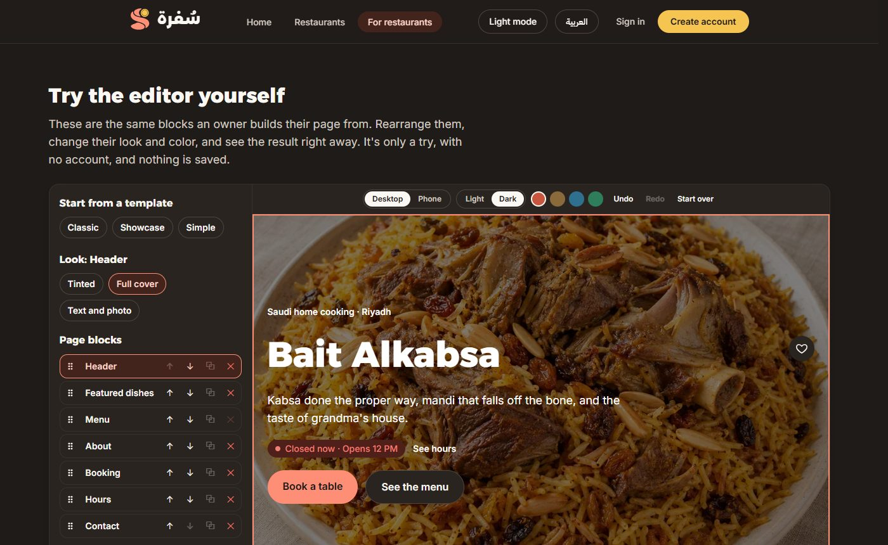
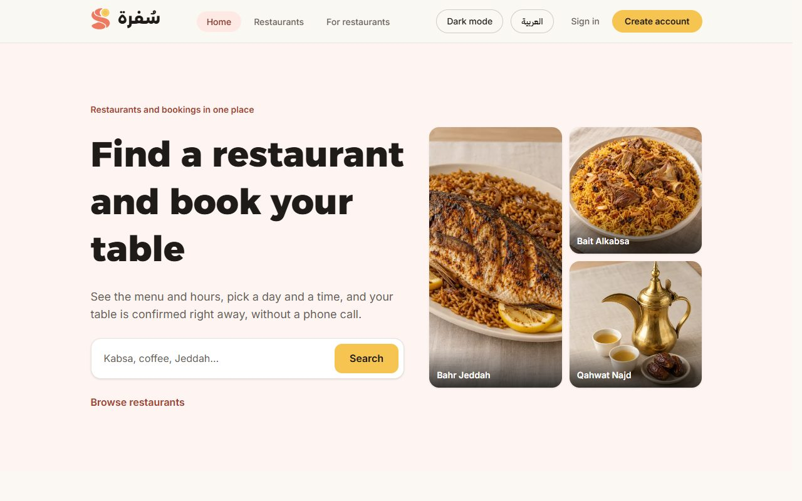
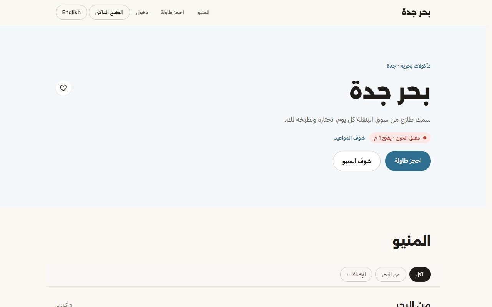
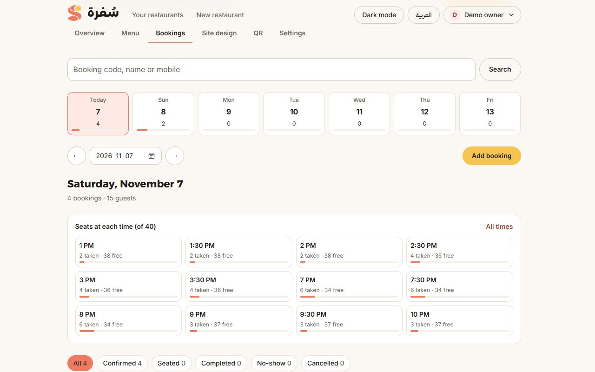
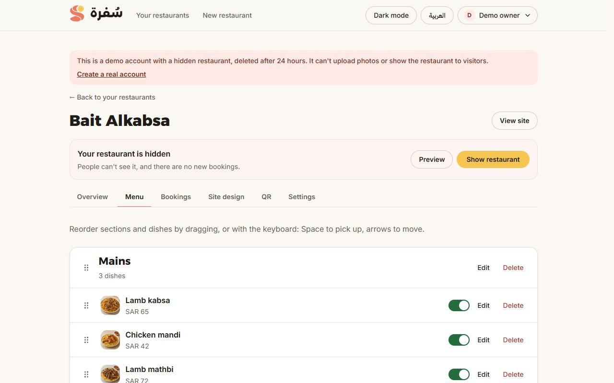

# Sufra · سُفرة

[](https://github.com/deved234/sufra/actions/workflows/ci.yml)

A multi-tenant restaurant platform: every restaurant gets its own branded website, in Arabic and English, with a menu it manages from a dashboard.

**Live:** https://sufra-sandy.vercel.app

## Try it in a minute

No sign-up for any of these:

- **As a customer:** browse [a restaurant](https://sufra-sandy.vercel.app/en/r/bait-alkabsa) and [search the directory](https://sufra-sandy.vercel.app/en/explore).
- **As an owner:** press **Try the dashboard, no account** on [the owners' page](https://sufra-sandy.vercel.app/en/for-restaurants). You get a private restaurant with sample bookings to manage, deleted after 24 hours.
- **The page editor:** rearrange a sample page right on [the same page](https://sufra-sandy.vercel.app/en/for-restaurants#try).



| | |
|---|---|
|  |  |
|  |  |

## What it does

- **Restaurant sites** at `/r/[slug]`, themed from a single accent color (contrast checked against WCAG AA in light and dark mode), with an "open now" badge in Riyadh time and a filterable menu.
- **Dish pages** that open as a modal from the menu (intercepting routes) and as a full page from a direct link.
- **Arabic and English** with `next-intl`: Arabic at the plain URLs (RTL), English under `/en` (LTR), hreflang on every page.
- **Accounts**: email and password or Google, email confirmation before private pages open, password reset, and an account page to change details, password and email, sign out other devices, or delete the account.
- **Table booking**: pick a party, day and time, confirm from an account, and manage it from "My bookings". Either side can ask to change a booking, and the other accepts or declines.
- **Favorites and discovery**: a restaurant directory at `/explore` with search and filters, and saved restaurants on the account.
- **Publishing and hours**: restaurants start as drafts with a private preview, can be hidden or deleted, and set up to two periods per day plus holidays, days without bookings and date ranges like Ramadan. Bookings follow all of it.
- **Admin panel** at `/admin`: every restaurant, account and booking on the platform with search and filters, charts of daily activity, suspending and restoring restaurants and accounts, transferring ownership, editing any restaurant through its own dashboard, and a log of every admin action. It doesn't exist for anyone else, and the role is only granted by a script.
- **A clear way in for each visitor**: the home page is for people looking for a restaurant, and owners have their own page and sign-in at `/for-restaurants`. It's one set of accounts, and after signing in each account lands where it belongs.
- **Photos**: dish photos, a cover and a logo, cropped by drag, zoom or keyboard and shrunk in the browser, then uploaded straight to Cloudinary with a signature from the server, written by hand with no SDK.
- **QR codes**: a QR encoder written from the standard (Reed-Solomon, masking and all), checked against an independent decoder, with PNG and SVG downloads and a printable table card.
- **Site builder**: owners arrange their own page from blocks, each with its own looks and settings. Drag on a live preview at any screen size and in either language, undo anything, and it saves itself as a draft. Publishing checks that nothing visitors will read is missing and jumps to what is, and the last 20 versions can be reopened. Three templates to start from.
- **Two ways to try it with no account**: `/for-restaurants` has the editor's real block list, undo and page renderer working on a sample restaurant in the browser, and one press opens a temporary dashboard with its own sample data.
- **Booking reminders**: a daily job emails customers before their booking. Each booking is claimed in the database before sending, so a repeated run can't send twice.
- **The pages a real site needs**: a contact form that sends an email and stores nothing, privacy and terms pages that describe what the code really does, a sitemap in both languages, robots rules and a share image.
- **Owner dashboard**: create a restaurant, edit its details with a live theme preview, and edit the menu with drag and drop (mouse, touch and keyboard) and optimistic updates.

## Tech stack

- Next.js 16 (App Router, Cache Components, Server Actions, `proxy.js`)
- React 19 (`useOptimistic`, `useActionState`), JavaScript
- Tailwind CSS v4 with OKLCH design tokens
- MongoDB Atlas with the official driver and `$jsonSchema` validators
- zod, dnd-kit, GSAP, culori
- Deployed on Vercel

## How it's built

- **Static by default.** Restaurant and dish pages are prerendered. Data reads live in `src/lib/restaurants.js` behind `"use cache"` with per-restaurant tags, so a save in the dashboard refreshes only that restaurant (`updateTag`).
- **Auth without a service.** Passwords are hashed with Node's `scrypt` (OWASP parameters). Sessions are random tokens in an `httpOnly`, `SameSite=Lax` cookie; MongoDB stores only their SHA-256 and expires them with a TTL index. Sign-in and sign-up are rate limited per email, per IP and per pair.
- **Email links done carefully.** Confirmation and reset links carry a random token whose hash is stored with a purpose, an expiry (TTL index) and the address it was sent to; `findOneAndDelete` makes each link work exactly once. Opening a link only shows a page, and a button press uses it, so mail scanners can't burn it. Sign-up and "forgot password" give the same answer whether or not an account exists, and send their email after the response (`after()`), so neither the answer nor its timing reveals who has an account.
- **Google sign-in by hand.** OAuth 2.0 authorization code flow with PKCE (RFC 7636) and OpenID Connect, written with `fetch` and `node:crypto`. `state` and `nonce` travel in a short-lived `httpOnly` cookie; the `id_token` is checked in `src/lib/auth/jwt.js` (RS256 only, signature against Google's cached JWKS, then issuer, audience, expiry and nonce). Accounts are matched by Google's `sub`, not the email; an existing password account is linked only through Google's verified email, and an unconfirmed password on it is dropped, so nobody can pre-register someone else's address and wait.
- **Email by hand.** `src/lib/email/` holds a small SMTP client over TLS (RFC 5321, AUTH PLAIN) and a MIME builder (multipart/alternative, RFC 2047 encoded Arabic headers, base64 bodies). Templates are table-based HTML with inline styles, in both languages, each with a plain text version.
- **Table booking without overbooking.** Seats per half hour live in one document per restaurant and day, and a booking takes all its half hours in one conditional `$inc`. MongoDB applies a single-document update atomically, so "is there room?" and "take it" are one step, with no transaction. Slot math (`src/lib/booking-slots.js`) is shared by the page and the server and handles hours past midnight. Choosing a table is public; confirming needs an account with a confirmed email, and the visitor's choices live in the URL, so they survive sign-in. Neither side can move a booking alone: a change is a request with a reason, and seats only move, atomically, when the other side accepts.
- **Authorization in every action.** `src/lib/auth/dal.js` is the only place that turns the cookie into a user. Every Server Action checks the user and the restaurant owner in the database query itself; the proxy only redirects signed-out page visits.
- **Safe concurrent menu edits.** The editor and the server share pure functions (`src/lib/menu-ops.js`). The server saves with compare-and-swap and retries when another tab saved in between.
- **One render for the server and the editor.** A page is a list of typed blocks whose components run on the server for visitors and in the browser for the live preview, sized with container queries so a phone-sized page can show on a computer. Edits are pure functions that make new lists, so an undo step is just a reference to an old list, and autosave can tell by reference that there's nothing to save. Drafts live apart from the restaurant, so they can't reach a public page.
- **Demo accounts that can't do harm.** Each visitor gets a separate temporary account, signed in with no password, on an address that can't receive mail. The server refuses whatever would spend money, send email or reach other people, an expired account is signed out at once, and a daily job removes what's left. See `src/lib/demo/`.
- **Two layers of validation.** zod on the server for form input, and MongoDB `$jsonSchema` validators (`src/db/schema.js`) on every write.

## Quality

Every push runs ESLint, a WCAG contrast check of the theme colors, unit tests, database tests of what happens under concurrent requests, a production build, and browser journeys with Playwright, against a throwaway MongoDB. The journeys include [axe](https://github.com/dequelabs/axe-core-npm) on every public page, in both languages and color modes.

Lighthouse on the live site, one run per page on November 7, 2026, simulating a mid-range phone and then a desktop:

| Page | Performance (phone / desktop) | Largest paint on a phone | Accessibility | Best practices | SEO |
|---|---|---|---|---|---|
| Home | 82 / 97 | 4.9 s | 100 | 100 | 100 |
| For restaurants | 88 / 99 | 3.9 s | 100 | 100 | 100 |
| A restaurant | 86 / 99 | 3.9 s | 100 | 100 | 100 |
| Booking | 90 / 100 | 3.4 s | 100 | 100 | 100 |

Layout shift was 0 on all of them. Automated checks catch only part of what makes a site accessible, and it hasn't been tested with people using screen readers.

## Getting started

```bash
npm install
cp .env.example .env.local   # then fill in MONGODB_URI
npm run db:setup             # collections, validators and indexes
npm run db:seed              # the three demo restaurants
npm run dev
```

Open [http://localhost:3000](http://localhost:3000).

## Scripts

| Script | What it does |
| --- | --- |
| `npm run dev` / `build` / `start` | Next.js |
| `npm run lint` | ESLint |
| `npm test` | Unit tests with Node's own test runner: booking slots, opening hours, the menu and site editors, JWT checks, email encoding, and the QR encoder against an independent decoder |
| `npm run test:db` | Concurrency tests on a real database: simultaneous bookings never go over capacity |
| `npm run test:e2e` | Browser journeys with Playwright, against a production build. Run `npm run build` first |
| `npm run check:themes` | Checks every theme color pair for WCAG contrast on real, extreme and random accents |
| `npm run db:setup` | Creates or updates collections, validators and indexes (safe to rerun) |
| `npm run db:seed` | Writes the demo restaurants by slug (safe to rerun) |
| `npm run make-admin -- email` | Makes an account an admin, `--remove` takes it away |

`test:db` and `test:e2e` write to the database, so they refuse anything but a local one unless `E2E_ALLOW_LIVE_DB=1` is set. Point them at a local MongoDB with `MONGODB_URI` and a separate `MONGODB_DB`. GitHub Actions runs everything on each push, with a database that exists only for that run.

## Environment variables

| Name | Purpose |
| --- | --- |
| `MONGODB_URI` | Atlas connection string for the app user |
| `MONGODB_DB` | Database name, `sufra` by default. Use separate ones for local work and Preview deployments |
| `SMTP_USER`, `SMTP_PASS` | The Gmail address and app password emails are sent from. Empty locally: emails print to the console |
| `CONTACT_EMAIL` | Optional. Where the contact form's messages go, `SMTP_USER` by default |
| `CRON_SECRET` | A long random string. Vercel sends it with the daily booking reminder job, which is refused without it |
| `GOOGLE_CLIENT_ID`, `GOOGLE_CLIENT_SECRET` | The Google OAuth client for "Continue with Google". Empty: the button is hidden |

## Known limits

- It's a demo and learning project, not a commercial service. The legal pages describe what the code does and haven't been reviewed by a lawyer.
- Booking reminders run once a day, at a time Vercel's free plan may move within the hour, and a run that Vercel misses isn't made up for bookings starting before the next one.
- Email goes through a Gmail account, which limits how much the site can send in a day.
- Bookings have no payment or deposit, and times are all in Riyadh time.

## License

[MIT](LICENSE)
